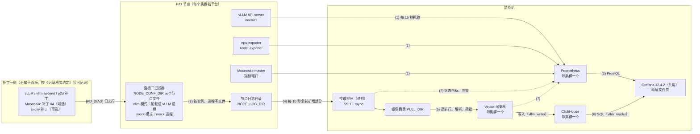

# 01 全景：机器、组件与数据流

本文说明内网上两个面板由哪些机器和程序组成、数据怎样流动，以及面板二与 vLLM 补丁之间的分界。各集群的具体名字、版本、端口和目录见 [02-内网现状](02-内网现状.md) 与 [`state/内网现状.yaml`](../state/内网现状.yaml)；面板本身的看板与段定义见 [10-面板一](10-面板一.md)、[20-面板二](20-面板二.md)；更完整的原理与接口见《[面板系统说明书](面板系统说明书.zh-CN.md)》（v3.1-extra）第一部分。

约定：

- 状态时点为 T51 的两份内网手册执行完以后（2026-11-19）：面板二的集群 `test` 已删除，`test-glm53` 已装在原来那两台机器上。
- 地址一律写占位符（`<监控机>`、`<P节点1>` 等）；需要示例地址时只用示例集 `10.1.x.x`。
- 目录写占位符：`<ROOT>` 为面板目录的上级目录（脚本里的 `ROOT`、`VLLM_PD_ROOT`，手册里也写作 `<总目录>`），`<用户目录>` 为监控机上放部署包和更新脚本的个人目录（更新脚本里的 `USER_DIR`）。

## 1. 两个面板

| | 面板一：服务侧指标 | 面板二：请求时延拆解（L1/L2/L3） |
|---|---|---|
| 回答的问题 | 每个 vLLM 实例和每台机器现在运行得怎样：请求数、吞吐、时延分布、调度、KV cache、Mooncake、NPU 与主机资源 | 一个请求在 P、D 两侧各经过哪些阶段、每段多长 |
| 数据形态 | 时序指标，每 15 秒一个点 | 逐请求的记录：每个请求每侧一行汇总，另有请求级事件 |
| 数据来源 | 节点上已有的指标端口：vLLM API server 的 `/metrics`、npu-exporter、node_exporter、Mooncake master | vLLM 进程写出的 `[PD_DIAG]` 日志行（mock 模式下由 mock 写入程序生成同格式的行）；可选的 proxy 行和 Mooncake `[BatchPutTiming]` 行 |
| 存储 | 每个集群一个 Prometheus（v3.11.2），内网保留 15 天 | 每个集群一个 ClickHouse（`clickhouse-server:26.8.36.3`），汇总表保留 30 天、事件表 15 天 |
| 看板 | 每个集群两张：「vLLM 服务侧监控面板 - Prefill实例（集群）」「… - Decode实例（集群）」 | 每个集群一张：「面板二：请求时延拆解（P / D）（集群）」 |
| 部署包 | 面板一部署包（`panel1/pack/vllm-pd-grafana-panel1/`，在用 tar sha256 前 8 位 `60ce7f30`） | 面板二部署包（`panel2/vllm-pd-grafana-panel2/`，在用 v3 `3e98c2b4`、v3.1-extra `e3885b93`） |
| 节点上的东西 | 没有任何文件，只访问已有端口 | `NODE_CONF_DIR` 里的三个节点文件、`NODE_LOG_DIR` 里过滤器写的日志；mock 模式另有 mock 进程 |

两个面板共用同一个 Grafana（12.4.2）。面板二借用面板一的 Prometheus 监视自己的采集链路并告警；没有面板一的集群另起一个只用于告警的 Prometheus。出处：《面板系统说明书》第 1.1、3.5 节。

## 2. 内网有哪些机器，各跑什么

| 机器 | 数量 | 运行的东西 | 属于哪个面板 | 出处 |
|---|---|---|---|---|
| 监控机 `<监控机>` | 1 台，aarch64 | 共用 Grafana 容器；每个集群一个 Prometheus 容器 `vllm-pd-prometheus-<集群>`（8 套面板一各一个，`test-glm53` 另有一个只告警的）；每个面板二集群一个 ClickHouse 容器 `vllm-pd-clickhouse-<集群>`、一个 Vector 采集器容器 `vllm-pd-vector-<集群>`、一个拉取程序（监控机上的后台进程，不是容器）；注册表 `~/.vllm-pd-clusters.json`；部署包、更新脚本、整理看板工具 | 两个面板 | 说明书第 1.3、5.2 节；T45 镜像同步记录（2026-11-18）；《面板二：删除 test、安装 test-glm53 操作手册》 |
| P、D 节点 | 9 个集群，见 02 第 6 节 | vLLM 容器（每个实例一个 API server）；npu-exporter、node_exporter（现场自装，面板一的前提）；每个集群一个 Mooncake master；面板二集群另有节点过滤器（三个节点文件，由 vLLM 进程加载或由 mock 进程加载） | 面板一抓指标端口；面板二只在 glm53-1、test-glm53 两个集群的节点上 | 说明书第 1.3、8.5 节；《面板一加集群说明书》0.4 节 |
| proxy 机器 `<proxy机器>` | test-glm53 一台 | vllm-ascend 的 `load_balance_proxy_server_example.py`；打了 proxy 补丁并设 `PD_PROXY_DIAG=1` 时，每个请求结束写一行 | 面板二的可选来源（`PROXY_COLLECT=1`） | 说明书第 3.2 节；面板手册第 17 步 |

监控机不需要 docker compose，也不需要上网；镜像、插件和 Python 由离线包提供。执行账号能免密 SSH 到面板二集群的全部节点（拉取程序和 `bin/nodes.sh` 靠它）。出处：说明书第 5.2 节。

## 3. 总体结构图

| 编号 | 从 → 到 | 方式 | 频率 |
|---|---|---|---|
| (1) | 节点指标端口 → Prometheus | Prometheus 主动 HTTP GET `/metrics`；抓取目标由 `inventory.json` 生成的 `prometheus.yml` 决定 | 每 15 秒 |
| (2) | Prometheus → Grafana | 打开或刷新看板时发 PromQL | 看板刷新时 |
| (3) | 过滤器 → 节点日志目录 | 写本地文件；请求级记录随到随写，按步累计行每 5 秒，自检行每 60 秒；单文件 256 MiB 换新，超过 `NODE_LOG_KEEP_HOURS`（留空为 12 小时）的旧文件自删 | 连续 |
| (4) | 节点日志目录 → 监控机镜像目录 | 拉取程序经 SSH 执行 rsync（默认 `--append`），节点删掉的旧文件镜像里也删 | 每 10 秒 |
| (5) | 镜像目录 → ClickHouse | Vector 读新增的行、解析后经 HTTP 写入；ClickHouse 写不进时暂存在磁盘缓冲 | 连续，攒批最多 5 秒 |
| (6) | ClickHouse → Grafana | 看板只读视图 `vllm_pd.phase_line_cur` | 看板刷新时 |
| (7) | 拉取程序、采集器 → Prometheus | 状态端口被抓取，6 条告警规则；告警只在 Prometheus 的 `/alerts` 页面显示，没有 Alertmanager | 每 15 秒 |

从节点写下一行日志到看板上查得到，实验室实测中位数约 10 秒、最长约 16 秒。出处：说明书第 1.4、3.2、8.8 节。

## 4. 面板一的数据怎么走

1. 每个集群有一份清单 `<ROOT>/vllm-pd-grafana-panel1/<集群>/prometheus/inventory.json`：每侧实例的 API server（`IP:端口`，按 DP rank 排，第 n 项即 `P<n>` / `D<n>`）、每实例进程数、两个 exporter 的端口、Mooncake master、抓取间隔与保留期。7 套新集群的清单由 `tools/make_inventories.py` 从机器表 `tools/clusters.txt` 生成，默认值取自 glm53-1 的清单。
2. `bin/panel1_cluster.sh add <集群>` 由清单生成 `prometheus.yml`，起 Prometheus 容器（主机端口为端口基数 + 2），建数据源「Prometheus（集群）」并经 Grafana API 导入两张看板；重做 `add` 即更新，`prometheus.yml` 热加载、数据不断。
3. 看板顶部有「模型」「实例」两个下拉框；部分 panel 需要 vllm-ascend 打了面板一的指标补丁才有数据，不打补丁时显示 No data（名单见部署包 README「不打补丁时缺什么」）。

出处：说明书第 2 节；《面板一加集群说明书》第 6–10 步。

## 5. 面板二的数据怎么走

1. 监控机把三个**节点文件**下发到每台节点的 `NODE_CONF_DIR`：`pd_diag_logging.json`（vLLM 的日志配置）、`pd_diag_logfilter.py`（过滤器）、`segments.json`（映射规则：哪条记录的哪个字段对应看板上的哪一段）。
2. **vllm 模式**（test-glm53）：vLLM 启动脚本在 `vllm serve` 之前设 `VLLM_LOGGING_CONFIG_PATH=<节点目录>/conf/pd_diag_logging.json` 和 `PYTHONPATH=<节点目录>/conf…`，`conf`（只读）与 `logs` 两个目录挂进 vLLM 容器；过滤器在 vLLM 的 API server、EngineCore、Worker 进程里挑出 `[PD_DIAG]` 行写盘。**mock 模式**（glm53-1）：节点上每个实例一个 mock 进程（`pd032_mock.py`，`nice 19`），按 `MOCK_RATE` 生成同格式的日志，经同一个过滤器写盘，由监控机上的 `bin/nodes.sh start|stop` 启停。
3. 拉取程序把各节点的 `NODE_LOG_DIR` 复制到 `PULL_DIR`，Vector 解析后写入 ClickHouse 库 `vllm_pd`，看板读视图 `phase_line_cur`（只含当前 `segments.json` 版本写出的行）。
4. **版本串**：`segments.json` 的 `config_id` 加文件内容 SHA-1 前 8 位；过滤器把它写进自检行，`check` 用它核对节点上跑的是不是监控机上那一份规则。只改 `segments.json` 不用重启 vLLM（过滤器每 2 秒查看修改时间）；改过滤器或日志配置要重启 vLLM。
5. **段定义按集群选**（v3.1-extra）：`deploy.env` 的 `SEGMENTS_PROFILE` 留空用包根目录那份（与 v3 相同），填 `glm53` 用 `profiles/glm53/segments.json`。段严格等于用户给定的 L1/L2/L3 共 47 段。
6. **两个可选来源**（v3.1-extra，`deploy.env` 打开时才有）：`PROXY_COLLECT=1` 时拉取程序复制 proxy 机器上的 `PROXY_LOG_DIR`，写入表 `proxy_line`；`MOONCAKE_LOG_COLLECT=1` 时拉取程序按 `MOONCAKE_LOG_FILES` 从 P 实例的 vLLM 日志里只取 `[BatchPutTiming]` 行，配给缓存池保存记录后写入 `phase_line`。

出处：说明书第 3.2–3.4、3.6 节。

## 6. 补丁与面板二的分界

面板二不规定 vLLM 怎样打点，只读取补丁写出的记录。两边以《记录格式约定》（[`contracts/记录格式约定-glm5.3-v1.3.3.zh-CN.md`](../contracts/记录格式约定-glm5.3-v1.3.3.zh-CN.md)，内容版本以文件内的说明为准）为界：

| 一侧 | 负责 | 不负责 |
|---|---|---|
| 补丁（vLLM 补丁 01 移植到 v0.30.0、vllm-ascend 缓存池与 V1 runner、`MooncakeConnectorV1` 打点、Mooncake 补丁 04） | 按约定写出 `[PD_DIAG]` 行（logger `vllm.v1.metrics.pd_diagnostics`、INFO 级、JSON `version` 为 2）及 `[BatchPutTiming]` 行；字段名、类型、时钟口径、`execution_id` 格式 | 过滤器和看板怎样取值 |
| 面板二（过滤器、`segments.json`、Vector、ClickHouse、看板） | 按约定解析记录、按 `segments.json` 映射成 47 段 | 补丁本身；补丁在节点容器里的安装与回滚 |

约定的规则：行格式不变、只做加法、不新增 `event` 种类、新增字段要写明核对用途；改约定要先经两边确认。打补丁的做法在《glm5.3 测试集群打补丁操作手册》，适用对象只有 test-glm53 的两台机器；glm53-1 的真实 vLLM 尚未接入面板二。出处：《记录格式约定》第 0 节；T51 任务记录（2026-11-19）。

## 7. 名字与端口的派生规则

一个集群的全部名字由**集群名** c 和**端口基数** B 决定。`add` 在注册表里从 18100 起找第一个空闲的端口段，每段 10 个端口（`names.py` 的 `PORT_FIRST, PORT_LAST, PORT_STEP = 18100, 19990, 10`）。

| 对象 | 名字 |
|---|---|
| 面板一目录 / 面板二集群目录 | `<ROOT>/vllm-pd-grafana-panel1/c` / `<ROOT>/vllm-pd-grafana-panel2/c` |
| 面板二工作目录 `TIMING_HOME` | `<ROOT>/vllm-timing/c`（拉取状态在 `puller/`；未设 `CLICKHOUSE_DATA_DIR` 时镜像目录是其下的 `pull/`） |
| 容器 | `vllm-pd-prometheus-c`、`vllm-pd-clickhouse-c`、`vllm-pd-vector-c` |
| 主机端口 | ClickHouse = B，拉取程序状态端口 = B+1，Prometheus = B+2 |
| 数据卷 | `vllm-pd-prometheus-data-c`；未设 `CLICKHOUSE_DATA_DIR` 时另有 `vllm-pd-clickhouse-c-data`、`-logs`、`vllm-pd-vector-c-data` |
| Grafana | 面板一数据源 UID `prometheus-c`、看板 UID `vllm-pd-prefill-c`、`vllm-pd-decode-c`；面板二数据源 UID `vllm-pd-clickhouse-c`、看板 UID `vllm-pd-request-c` |
| Prometheus 抓取任务 | 面板一 `vllm-prefill`、`vllm-decode`、`npu-exporter`、`node-exporter`、`mooncake-master`；面板二 `vllm-timing-puller-c`、`vllm-timing-central-c` |

集群名只能用小写字母、数字和 `-`，Grafana 的 UID 也不能带点；因此 dsv4.1-flash 的 5 套内部名是 `dsv41-flash-N`，显示名 `dsv4.1-flash-N` 只出现在文件夹和看板标题里。注册表在安装前按容器、端口、目录、UID、Prometheus 配置文件和机器查重，一台节点只能属于一个集群。出处：说明书第 4 节；T45 方案（2026-11-17）。

## 8. 三层组织：文件夹 → 集群 → 面板

- Grafana 按「上一层文件夹（模型）/ 子文件夹（集群）」两层组织：`GLM-5.3/…`、`dsv4.1-flash/…`。树和每个文件夹里的看板见 02 第 5 节。
- 每个集群的 `MODEL_GROUP`（注册表的 `model_group` 和各 `deploy.env`）等于它的子文件夹名。两个部署包都只在**顶层**找名为 `MODEL_GROUP` 的文件夹，找不到就在顶层新建；所以任何 `add`、更新、回滚以后，看板会落到顶层，需要执行一次 `tools/arrange_boards.py apply`，按对照表 `tools/boards_layout.txt` 挪回子文件夹（并把 dsv 看板标题里的集群名换成显示名、删掉顶层的空文件夹）。按 UID 操作，链接与收藏不变。
- 一个集群可以只装面板一、只装面板二或两者都装。

出处：T45 方案与交付（2026-11-17、11-18）；《动现有看板操作单》0.4 节。

## 出处

| 文档 | 用到的内容 |
|---|---|
| 《面板系统说明书》v3.1-extra（`docs/面板系统说明书.zh-CN.md`） | 第一部分原理、第 4 节名字规则、第 5–8 节部署与目录 |
| 《面板二：删除 test、安装 test-glm53 操作手册》（T51，2026-11-19） | test-glm53 的部署方式、自己的 Prometheus、可选来源 |
| 《面板一加集群说明书》《动现有看板操作单》（T45，2026-11-17） | 面板一多集群、两层文件夹、`arrange_boards.py` |
| 《记录格式约定》glm5.3 版（T51，2026-11-19） | 补丁与面板二的分界 |
| T45 镜像同步交付记录（2026-11-18） | 监控机上的容器组成 |
