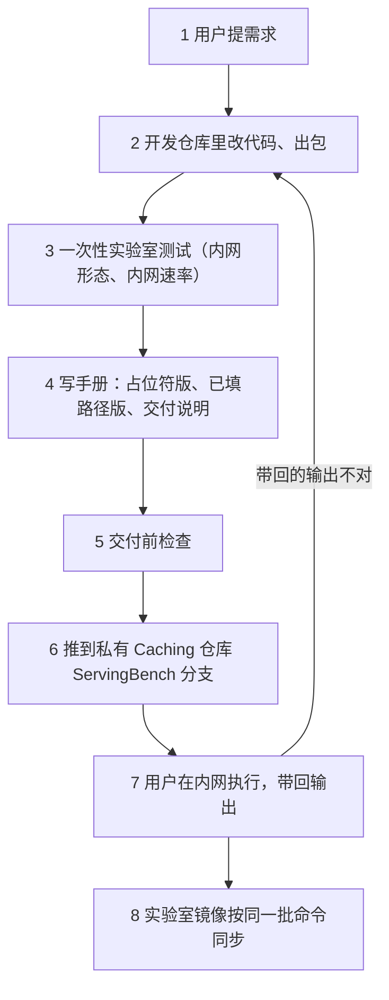

# 30 变更与发布：实际做法

本文记录 T26 至 T51（2026-11-12 至 11-19）对面板一、面板二做变更时实际采用的流程，不是理想流程；最后一节说明迁到本仓库以后的做法。内网现状见 [02-内网现状](02-内网现状.md)，规则与用户的决定见 [40-规则](40-规则.md)，已知问题见 [50-已知问题与待办](50-已知问题与待办.md)。

## 1. 流程总览

| # | 步骤 | 执行者 | 产物 | 出处示例 |
|---|---|---|---|---|
| 1 | 提需求 | 用户 | 需求原话、任务编号 | T45（2026-11-17）、T51（2026-11-18） |
| 2 | 改代码、出包 | 开发侧 | tar、`.sha256`、包内 `MANIFEST.txt` 与 `SHA256SUMS` | 面板二 v3.1-extra `e3885b93`（T51） |
| 3 | 一次性实验室测试 | 开发侧 | 走查记录（例如 `panel2/tests/t51/results/`） | T51 面板手册走查 |
| 4 | 写手册 | 开发侧 | 占位符版、已填路径版、交付说明 | 《面板二：删除 test、安装 test-glm53 操作手册》 |
| 5 | 交付前检查 | 开发侧 | 检查单各项结果、泄漏检查输出 | T32 交付前检查单 |
| 6 | 推送 | 开发侧 | ServingBench 分支上的一个提交 | 例如「test-glm53 面板包 e3885b93」 |
| 7 | 内网执行 | 用户 | 带回的输出 | T51，2026-11-19 21:3x |
| 8 | 镜像同步 | 开发侧 | 同步记录 | T45 镜像同步交付记录（2026-11-18） |

## 2. 各步的做法

### 2.1 提需求

- 用户在对话中提出需求，原话和之后的每个决定记进任务记录，按任务编号（T26、T45、T51 …）引用。
- 改动依赖内网环境时，先把改动清单、环境假设表和要问的问题发给用户，确认后再做。
- 产品范围（例如段的增删、哪些集群接哪个面板）由用户定；实现上的正确性取舍由开发侧定。

### 2.2 在开发仓库里改代码、出包

| 面板 | 源码 | 出包 | 说明 |
|---|---|---|---|
| 面板一 | `panel1/pack/vllm-pd-grafana-panel1/` | `panel1/tools/build_pack.sh`：写包内 `MANIFEST.txt`（构建时间、镜像版本）、`SHA256SUMS`，在 `panel1/dist/` 生成 `vllm-pd-grafana-panel1.tar.gz` 和 `.sha256` | T26 起看板是合并后的基线，出包时设 `NO_EXPORT=1`，否则脚本先从 demo 页面重新导出看板、覆盖基线（脚本内注释）。导入本仓库以前没有 git 历史 |
| 面板二 | `panel2/vllm-pd-grafana-panel2/` | `panel2/tests/t41/build_pack.sh <输出目录> <提交>`：从指定提交 `git archive` 出包，写构建时间 | 段定义按环境放在 `profiles/<环境>/segments.json`；默认段定义下生成的 5 个文件必须和上一版逐字节相同（兼容性检查） |
| 面板二交付目录 | — | `panel2/tests/t41/pack_dist.sh <输出目录> [提交]`，带 `TAR_FROM=<走查用的 tar 所在目录>` | 核对走查用的 tar 与该提交的包逐文件相同；把 tar 的 sha256 填进两份更新脚本的 `P2_SHA`；填手册里的「待打包填」处并生成已填路径版；写 MANIFEST；做泄漏检查（2.5 节） |
| 更新脚本 | `panel2/update/`（`vllm_pd_update_pack2.py` 等） | 由 `pack_dist.sh` 填 `P2_SHA` | 脚本核对新包的 sha256，不等于 `P2_SHA` 时停下 |

tar 不能逐字节复现（gzip 头和包内的构建时间每次不同），所以**交付的是走查用过的那一份**，不是重新打的包；sha256 记的也是这一份。

### 2.3 一次性实验室测试

每次变更在开发机上新起一个一次性实验室，测完拆掉；不在实验室镜像上做未交付的改动。

| 要求 | 做法 | 来由 |
|---|---|---|
| 形态与内网相同 | 监控机容器（自带 dockerd、内部网络、离线导入镜像），节点容器按内网的机器数、实例数、TP 起；有 Python 与无 Python、aarch64 与 x86_64 的节点都覆盖；vllm 模式用把 `/data` 按内网方式挂进去的 vLLM 替身 | T32（2026-11-13）：实验室跑 2P5D，内网是 2P8D，漏掉了 D 积压 |
| 速率与内网相同 | `MOCK_RATE` 按 D 实例数换算：每个 D 实例稳定上限约 1.7–2.3 请求/秒，说明书要求每个 D 不超过 1.5 请求/秒；例如 2P8D 时按 8 个 D 定速率，glm53-1 的 64 个 D 对应 64 | T32：内网 2P8D 跑在 100 请求/秒，实验室只测了 4–8 |
| 不只测正常路径 | 积压下停 mock、异常状态、清数据、计时、中途失败、真实日志样本、vLLM 替身（T32 列为 T-1 至 T-10） | T32 |
| 逐字走手册 | 按顺序执行手册里的每个命令块（用走查脚本），用的是要交付的那个 tar；把实际输出贴进「应当看到」，实验室地址换成示例集 `10.1.x.x`，家目录写 `~` | T43、T45、T51 |
| 改了安装路径 | 另做一次从零开始的走查（别的目录、一次性注册表），再推送 | 2026-11-12 用户定的镜像规则 |
| 容器清理 | 容器用 `--rm` 或 `docker rm -fv`（不留匿名数据卷），不执行 prune；往 Docker 写入数 GB 前先查宿主机剩余空间；实验室前缀互不重名，避免 `down` 按前缀删掉别的实验室 | 2026-11-07、11-13 的磁盘事故；T51 |

### 2.4 写手册

**格式。** 每个目的一份线性手册（例如面板一份、打补丁一份）。第一页不超过一屏：做什么、做完是什么样子、各手册之间的总顺序、要先准备的现场值、对服务的影响。步骤 1..n 连续编号，每步四块：在哪台机器、命令、应当看到、不对时怎么办（停下，带回哪一段输出）；每步写明执行后马上看到什么（例如看板短时为空）和对同机其他服务的影响；要带回的输出在步骤里标「带回：」，文末汇总成带回清单。原因、已知问题、没测过的部分放附录，不放进步骤。命令照抄走查过的原文；新命令先在实验室走过再写进手册。出处：用户 2026-11-19 对 T51 手册的意见；`manuals/` 下的新式手册。

**两个版本。**

| 版本 | 内容 | 放在哪里 |
|---|---|---|
| 占位符版 | 路径写 `<用户目录>`、`<总目录>`；文首有一段用 `<!-- 占位符版开始 -->`、`<!-- 占位符版结束 -->` 包住的说明；`<!-- 占位符表开始 -->` 与 `<!-- 占位符表结束 -->` 之间是这两个路径占位符的说明行 | 进 git（`manuals/`） |
| 已填路径版 | 由 `fill_guide.py` 从占位符版生成：`python3 fill_guide.py <包二 v3 已填路径更新脚本> <占位符版> <输出>`。脚本从 `vllm_pd_update_pack2_filled.py` 的「现场路径」一段读 `USER_DIR`、`ROOT`，替换 `<用户目录>`、`<总目录>`，把占位符说明换成「路径已填好」的说明，删掉占位符表里这两行，标题后加「（路径已填好）」；其余尖括号里的现场值仍是占位符 | 只在本地 `local/`（过去推到私有 Caching 仓库） |

- 更新脚本同理：`_filled.py` 与占位符版只差「现场路径」一段的 `USER_DIR` 一行（包二 v3 的两份脚本逐行比较只差第 33 行）。实验室镜像上照用已填版，只把这一行改成实验室的用户目录，因此镜像上「核对更新脚本 sha256」一步必然报 `FAILED`，这是预期行为（T45 镜像同步记录第 4 节第 5 条）。
- 例外：T43、T45 的两份面板一说明书先写已填路径版，再用脚本生成占位符版；Caching 上的 `看板分层与加集群/` 只有已填路径版。
- 每次交付另附一份交付说明：各文件的 sha256、走查了什么、已知问题。

### 2.5 交付前检查

**T32 交付前检查单**（2026-11-13 起，每次推包前从上到下逐项过，一项不过就不推）：

| 组 | 检查项 |
|---|---|
| A 包本身 | 版本号三处一致（包内 `VERSION`、`MANIFEST.txt` 第二行、更新脚本 `PACK_VERSION`）；交付目录的 sha256 都对得上（`sha256sum -c`）；包和文档里没有真实日志内容和真实请求号；测试日志和摘要里没有凭据 |
| B 测试 | 实验室配置与内网一致（`deploy.env` 只差地址和凭据，清单的机器数、实例名、端口相同）；T-2 至 T-7、T-11 都过，且每份结果第一行记的 tar sha256 等于交付的 tar；改到 vllm 模式时 T-8 也过；真实日志样本符合预期（T-9） |
| C 说明 | 每条命令都按顺序在实验室执行过；会改数据、重启或删除东西的步骤，「几分钟后哪一项过」用实测的表；由没有参与编写的人（或新开的 AI 会话）按说明盲走一遍，缺陷为 0（T-10） |
| D 问题清单 | T32 问题清单每条在交付说明里有结论；以前实验室记录里的已知问题都有结论；数据准确性检查不拦升级 |
| E 收尾 | 一次性环境删干净；实验室镜像没被动；开发侧的变更记录加了这一版的一行 |

**泄漏检查。**

- `pack_dist.sh` 第 6 步：在交付目录和 tar 内部查用户目录，只允许两份已填路径文件含有它；交付目录和 tar 里不能留「待」字样的未填占位。
- 推送前在交付目录里查 IP 地址：示例只用示例集 `10.1.x.x`，贴进手册的实验室输出要换地址并说明（T43，2026-11-16）。
- 补丁包的个人信息扫描同时解开检测脚本里内嵌的 base64 + gzip 数据再查（T51，2026-11-19）。

**审查。** 冻结要交付的版本，定硬期限，只做一次限时审查；只修阻塞项、修一次，其余写进已知问题，不反复「修改—审查」（2026-11-11 起）。

### 2.6 推送到 Caching 仓库

- 私有仓库 Caching 的 `ServingBench` 分支（2026-11-07 起的独立分支），只做快进推送，不强推。
- 每次交付一个目录或一组文件，例如 `包二-v3/`、`包二-v3.1-extra/2-面板二v3.1-extra/`、`包二-v3.1-extra-glm53/00-操作手册-从这里开始/`；提交说明写包名和 sha256 前 8 位。
- git 单文件上限 100 MB，离线包切成 45 MB 分片推送，合并后的 sha256 写在 MANIFEST。
- 已填路径版也推在这个私有分支上（约 20 个文件含内网用户目录）；本仓库是公开仓库，不再这样做（第 3 节）。

### 2.7 用户在内网执行、带回输出

- 用户按手册逐步执行；输出与「应当看到」不同时停下，带回该步标「带回：」的输出；文末带回清单列出全部要带回的内容。
- 开发侧据带回的输出判断：符合预期的继续；手册写得不完整、但现场做法正确的，记为手册的已知问题，不在执行中途改手册（例如 T51 面板手册第 13 步缺第三条命令输出的样子，2026-11-19 21:3x）；需要改包的，回到第 2 步。
- 带回的输出是 `docs/02-内网现状.md` 与 `state/内网现状.yaml` 唯一可靠的更新依据。

### 2.8 实验室镜像同步

- 实验室镜像（`t14p2-*` 容器）只用交付给内网的同一批命令更新，命令逐字照抄，唯一的改动是路径（更新脚本 `USER_DIR` 一行、手册里的用户目录换成实验室的用户目录）。镜像不清理、不重建、不另行修改（2026-11-12 用户定）。
- 没有现成交付命令的部分照内网的结果手工做出，并在同步记录里写明与内网来历的不同（例如 T45 同步时 test 用 v3 包直接新装，内网是 v2.1 改名再升 v3）。
- 每次同步写一份记录：做之前 / 做完以后的状态、每一步的关键输出、与内网仍有的不同、手册在镜像上暴露的问题（只列，不改）。T45 的同步（包二 v2.0 → v2.1 → v3、建 test、动现有看板、加 7 套）约 40 分钟。
- 截至 2026-11-19，T51 的同步（删 test、装 test-glm53）尚未做，等内网做完后按同一批命令做。

## 3. sha256 怎么记

| 对象 | 记法 | 核对方式 |
|---|---|---|
| 部署包 tar | 旁边一个 `<tar>.sha256`；更新脚本里的 `P2_SHA`；手册里核对包的那一步写出 sha256（例如《面板一加集群说明书》第 3 步核对 `60ce7f30…`）；提交说明与文档写前 8 位 | 内网 `sha256sum -c <tar>.sha256`；更新脚本自动核对 |
| 包内文件 | 包内 `SHA256SUMS`；`MANIFEST.txt` 记版本、构建时间、来源提交、组件版本 | `sha256sum -c SHA256SUMS --quiet`；面板二 `check` 报「文件都和 SHA256SUMS 相同」 |
| 交付目录 | `<版本>-MANIFEST.txt`（tar、更新脚本、手册、离线包）或目录内 `SHA256SUMS` | 交付前检查单 A2 |
| 手册 | 交付说明写占位符版、已填路径版各自的 sha256 | — |
| 离线包 | 合并分片后的 sha256 写在 MANIFEST；包内 `offline/SHA256SUMS` | 手册解包一步 `(cd offline && sha256sum -c SHA256SUMS --quiet)` |
| 节点文件 | 面板二 `check` 比对节点上三个文件与监控机上的 sha256；过滤器自检行带版本串（`config_id` 加 SHA-1 前 8 位） | `bin/panel2_cluster.sh check <集群>` |

文档里引用一律写 sha256 前 8 位，全长以 `SHA256SUMS` 为准。

## 4. 以后在本仓库里

| 项 | 做法 |
|---|---|
| 包的存放 | 部署包、离线包、补丁包作为 GitHub Release 的资产（单文件上限 2 GiB），不进 git 历史；放的是走查用过的原件 |
| 版本对应 | 每个包对应一个 git tag；`releases/<tag>/SHA256SUMS` 进 git，记该 tag 下每个资产的 sha256；tag 名的格式尚未约定 |
| 手册 | 占位符版进 git（`manuals/`）；已填路径版只放本地 `local/`，由 `fill_guide.py` 按 `local/` 里的已填更新脚本生成 |
| 现场值 | 地址、主机名、用户目录、凭据只放 `local/`（例如 `local/site.env`）；`.gitignore` 已排除 `local/`、`*已填路径*`、`*_filled.py` |
| 状态文件 | 每次内网执行带回输出后，同时更新 `docs/02-内网现状.md` 与 `state/内网现状.yaml` |
| 发布前 | 第 2.5 节的检查照做；另对整个仓库做一次泄漏检查（内网地址、主机名、凭据、个人目录、本机路径） |
| 历史包 | 包一 v1.0、包二 v2.0、v2.1 等是否迁入本仓库未定（T52 待定问题）；在此之前以 Caching `ServingBench` 分支为历史记录 |

## 出处

| 文档或记录 | 日期 | 用到的内容 |
|---|---|---|
| T32 内网升级问题清单、交付前检查单 | 2026-11-13 | 实验室形态与速率、检查单 |
| `panel2/tests/t41/pack_dist.sh`、`build_pack.sh`；`panel1/tools/build_pack.sh` | — | 出包、填 `P2_SHA`、泄漏检查 |
| T51 打补丁包的 `fill_guide.py` | 2026-11-19 | 已填路径版的生成规则 |
| T45 镜像同步交付记录 | 2026-11-18 | 镜像同步的做法与用时 |
| T26 多集群交付、实验室镜像规则 | 2026-11-12 | 镜像只用交付命令更新、改安装路径另做从零走查 |
| T43 交付补充 | 2026-11-16 | 示例地址只用 `10.1.x.x` |
| T51 任务记录与两份手册 | 2026-11-19 | 线性手册格式、带回与已知问题的处理、镜像同步待做 |
| T52 交接方案 | 2026-11-19 | 本仓库的 Release、tag、`local/` 安排 |
